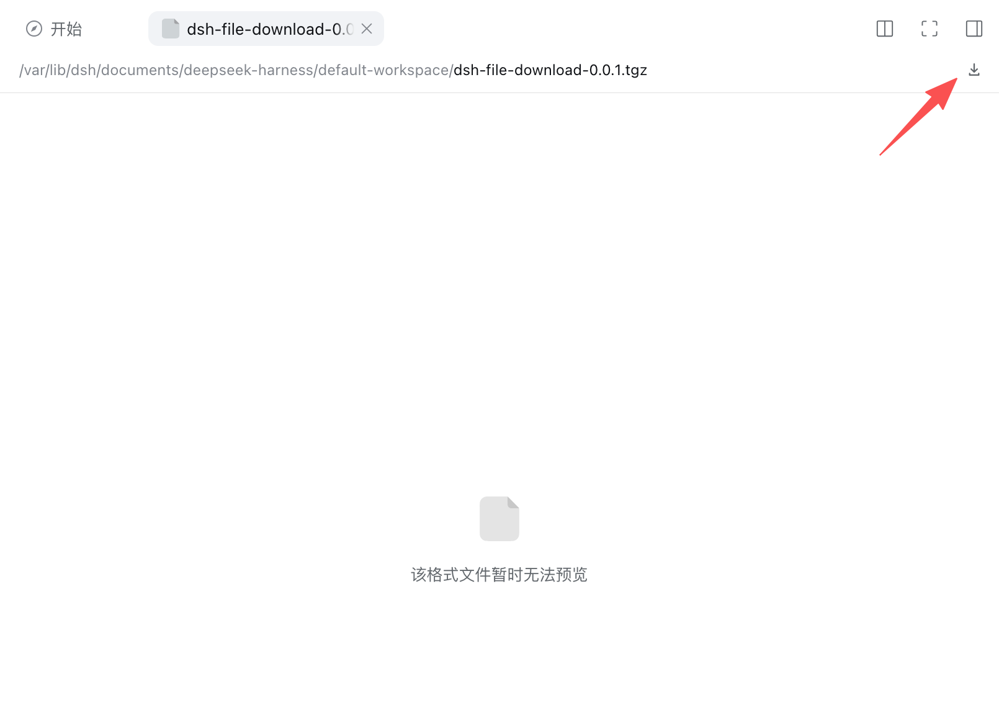

# dsh-file-export

[中文](docs/README.zh-CN.md)

An open-source DSH Web plugin that adds a download button to the document preview.

## Features

- Uses DSH's authenticated `workspaceFiles.readBytes` API for the previewed file.
- Shows a loading state and keeps the temporary Blob URL alive until the browser starts the download.
- Uses a compact icon-only control that matches the native preview toolbar.
- Does not register a custom HTTP download endpoint.
- Does not construct instance URLs or gateway prefixes.
- Provides Chinese and English UI strings.
- Keeps the first release intentionally small: it downloads the file currently shown in the preview.
- Declares a `dsh.bundle` layer so DSH can manage the plugin from Settings → Plugins.

## Directory structure

```text
dsh-file-export/
├── src/
│   ├── host/index.js        # Host entry; no host-side logic currently
│   └── client/              # Web client source
│       ├── index.js         # Injection, slot, and locale registration
│       ├── action.js        # Preview download action
│       ├── download.js      # readBytes, envelope, and Blob download
│       ├── glyphs.js        # Download and loading glyphs
│       ├── styles.js        # Button styles and spinner animation
│       └── locale.js        # Runtime dictionaries
├── lib/                     # Built files published to npm
├── assets/icon.svg          # Plugin manager icon
├── docs/download-preview.png  # Preview screenshot
├── locale/                  # Plugin manager metadata
├── cordis.patch.yml         # dsh.bundle patch layer
└── build.mjs               # esbuild build script
```

Preview:



## Install

```bash
dsh plugin --profile web add dsh-file-export@0.0.5
```

For a local package, create the npm tarball and install it:

```bash
npm pack
dsh plugin --profile web add ./dsh-file-export-0.0.5.tgz
```

Restart `dsh web` after installation if the current profile requests it.

## Build

```bash
npm install
npm run build
npm run check:build
```

`check:build` rebuilds the committed `lib/` directory and fails if the generated files differ. Run it before committing source changes so the npm package and Git source stay in sync.

To stage a release on npm:

```bash
npm run deploy
```

## Compatibility

The initial release targets DSH `0.2.1-rc.5` through the `0.2.x` line. The package declares this range in `engines.dsh` so the DSH plugin manager can reject incompatible profiles before activation.

The plugin does not introduce a server-side route. File access remains subject to DSH's authenticated workspace file service and its configured read limits.
