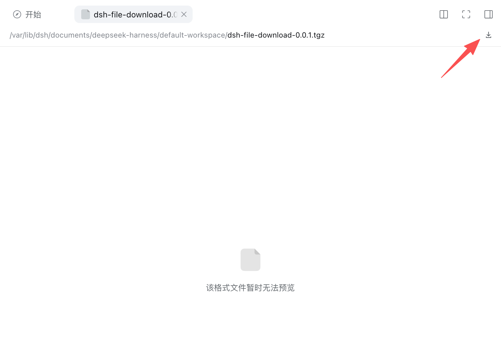

# dsh-file-export

[English](../README.md)

DSH Web 插件：在右侧文件预览区域提供下载按钮，使用官方 `workspaceFiles` Remote API 下载当前会话中的文件。

当前版本为 `0.0.1`，仓库地址为：
`https://github.com/feihua666/dsh-file-export`

## 特点

- 不注册自定义 HTTP 下载地址；
- 在右侧文件预览区域提供下载按钮；
- 通过 `workspaceFiles.readBytes` 读取预览中的文件并由浏览器下载；
- 下载期间显示 loading 状态，并在浏览器开始下载后再释放临时文件地址；
- 支持插件管理器和界面的中文、英文元数据。
- 下载按钮使用原生工具栏风格的图标，并在下载期间显示旋转状态；
- 不引入运行时第三方依赖。
- 声明 DSH `dsh.bundle` 组合包，可在插件管理中启用、停用和移除。

## 目录结构

```text
dsh-file-export/
├── src/
│   ├── host/index.js        # 宿主入口，当前没有宿主逻辑
│   └── client/              # Web 客户端源码
│       ├── index.js         # 注入声明、插槽注册、locale 注册
│       ├── action.js        # 预览区下载按钮
│       ├── download.js      # readBytes、信封解包和 Blob 下载
│       ├── glyphs.js        # 下载图标和 loading 图标
│       ├── styles.js        # 按钮样式和旋转动画
│       └── locale.js        # 中英文运行时字典
├── lib/                     # npm 发布的构建产物
├── assets/icon.svg          # 插件管理器图标
├── docs/download-preview.png  # 效果截图
├── locale/                  # 插件管理器标题和描述
├── cordis.patch.yml         # dsh.bundle 组合包 patch 层
└── build.mjs                # esbuild 构建脚本
```

效果图：



## 安装

```bash
dsh plugin --profile web add dsh-file-export@0.0.5
```

本地安装：

```bash
npm pack
dsh plugin --profile web add ./dsh-file-export-0.0.5.tgz
```

将插件加入 DSH 配置后重启 Web 客户端即可。

## 构建

```bash
npm install
npm run build
npm run check:build
```

`check:build` 会重新构建已提交的 `lib/` 目录；如果构建产物与仓库中的文件不一致，命令会失败。提交源码修改前应先执行该检查，避免 npm 包与 Git 仓库中的构建产物不一致。

发布前暂存到 npm：

```bash
npm run deploy
```

## 限制

首版只支持当前文件预览中的下载，不提供独立文件列表。完整文件读取受 DSH Workspace Files 的大小限制约束；大文件应后续增加分片下载。

## 开发检查

```bash
npm run build
node --check lib/client.js
node --check lib/index.js
npm pack --dry-run
```
